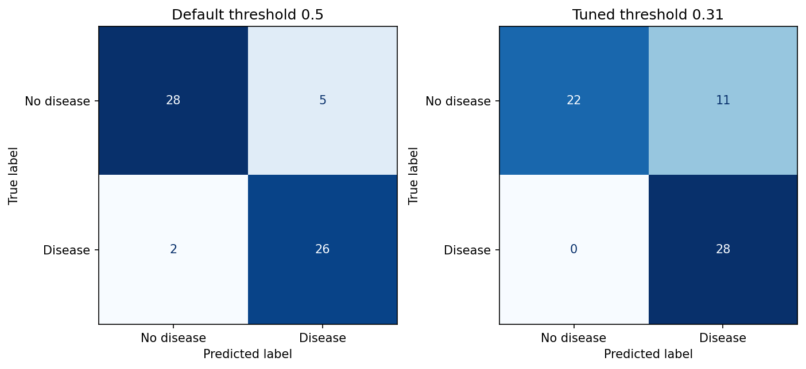
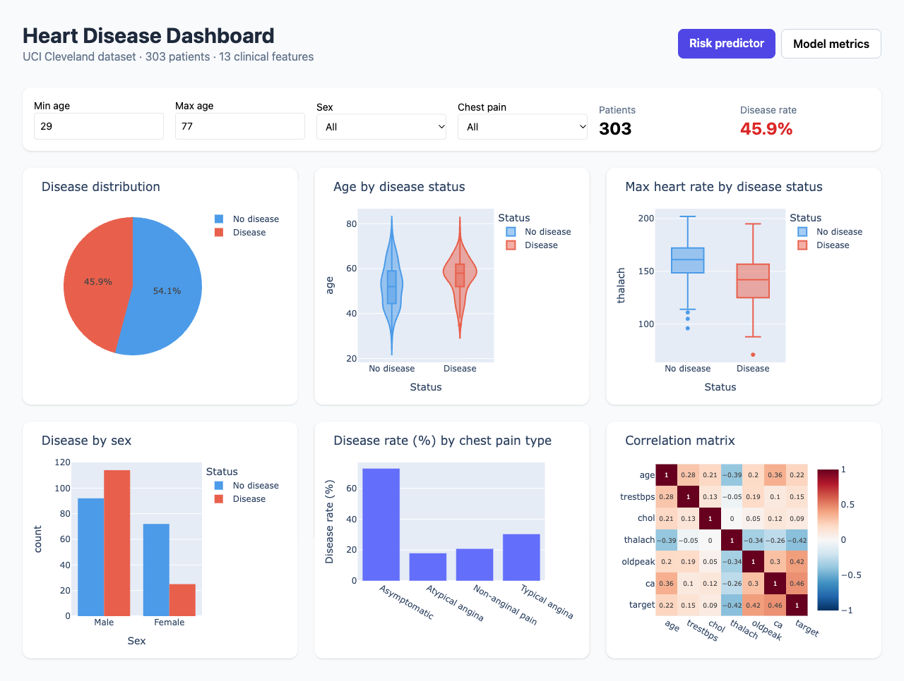
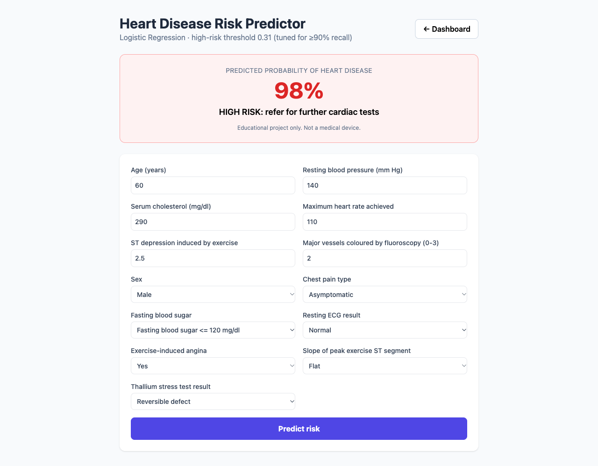
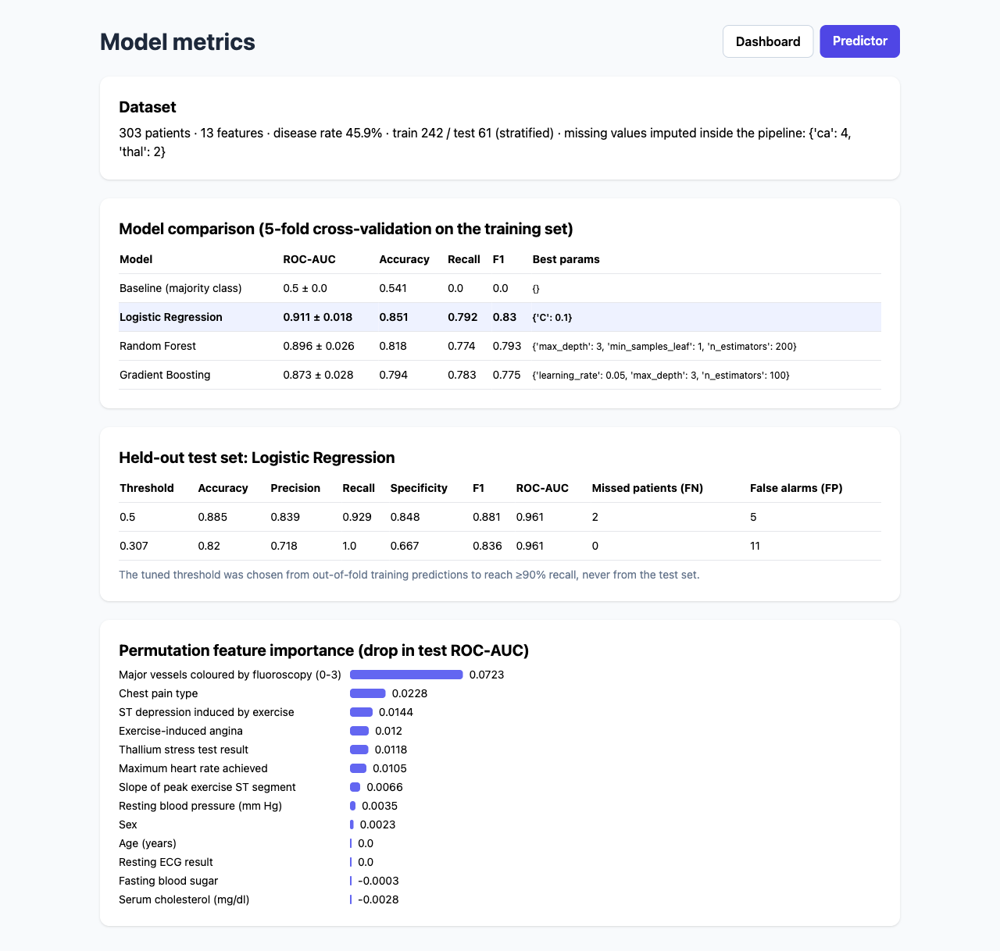
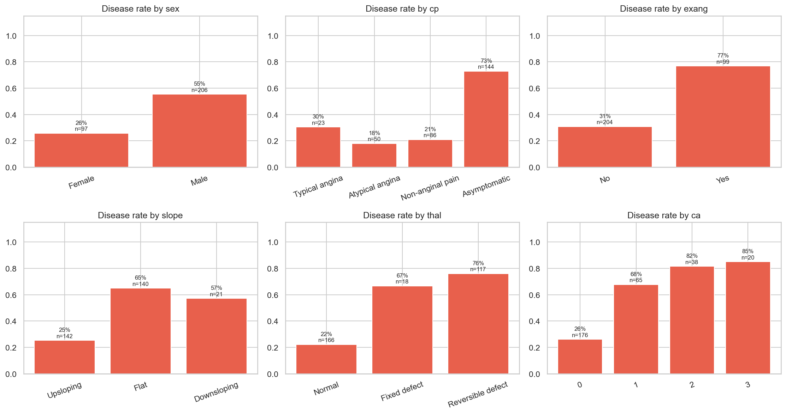

# Heart Disease Risk Prediction

An end-to-end data science project on the **UCI Cleveland Heart Disease** dataset: data download and validation, SQL analysis, exploratory analysis, a leakage-free modelling pipeline with model comparison and threshold tuning, and a Flask web app with an interactive dashboard and risk predictor.

**Question:** given 13 routine clinical measurements, can we flag which patients are likely to have heart disease, so they can be referred for further tests?



## Results

Five-fold stratified cross-validation on the training set (242 patients):

| Model | ROC-AUC | Accuracy | Recall | F1 |
|---|---|---|---|---|
| Baseline (always predict "no disease") | 0.500 | 0.541 | 0.000 | 0.000 |
| **Logistic Regression (C = 0.1)** ✅ | **0.911 ± 0.018** | **0.851** | 0.792 | **0.830** |
| Random Forest | 0.896 ± 0.026 | 0.818 | 0.774 | 0.793 |
| Gradient Boosting | 0.873 ± 0.028 | 0.794 | 0.783 | 0.775 |

Held-out test set (61 patients, evaluated once):

| Decision threshold | Accuracy | Precision | Recall | Specificity | ROC-AUC | Missed patients | False alarms |
|---|---|---|---|---|---|---|---|
| 0.50 (default) | 0.885 | 0.839 | 0.929 | 0.848 | 0.961 | 2 | 5 |
| **0.31 (tuned for ≥ 90% recall)** | 0.820 | 0.718 | **1.000** | 0.667 | 0.961 | **0** | 11 |

Key takeaways:
- **The simplest model won.** With only 303 patients, regularised Logistic Regression generalises better than tree ensembles, and its coefficients are directly interpretable (odds ratios).
- **Threshold tuning trades accuracy for safety.** In screening, a missed sick patient is far more costly than an extra test, so the threshold is lowered until recall ≥ 90%. It is chosen from *out-of-fold training predictions*, never from the test set.
- The test-set ROC-AUC (0.96) is higher than the CV estimate (0.91). With only 61 test patients a single split is noisy, so the **CV figure is the more reliable estimate**.

## Web app

A Flask app with three pages (run `python app.py`, then open http://127.0.0.1:5000).

### 1. Interactive dashboard (`/`)
Six Plotly charts that update live when you filter by age range, sex and chest pain type, plus the patient count and disease rate for the current filter.



### 2. Risk predictor (`/predict`)
Enter a patient's 13 clinical values and get the model's real predicted probability. It is labelled **high risk** when it crosses the recall-tuned threshold (0.31). Inputs are validated against plausible ranges and valid category codes.



### 3. Model metrics (`/metrics`)
Cross-validated model comparison, held-out test results at both thresholds, and permutation feature importance, all read from `artifacts/metrics.json`.



## What makes the pipeline leakage-free

The first version of this project fitted `StandardScaler` on the **whole dataset before** the train/test split, so test-set statistics leaked into training. It is now fixed:

```
raw CSV ──► clean_data.py (validate only: types, ranges, duplicates; no fitting)
        ──► train/test split (stratified, test set locked away)
        ──► sklearn Pipeline, fitted on training folds only
              ├─ numeric:      median imputation → StandardScaler
              ├─ categorical:  most-frequent imputation → one-hot encoding
              └─ model
```

Because preprocessing lives inside the `Pipeline`, `GridSearchCV` refits it inside every CV fold, and the **same fitted pipeline is saved and served** by the web app. Training and serving therefore can't drift apart. `tests/test_pipeline.py` checks that the scaler's means match the training rows only.

## Data

- **Source:** [UCI Machine Learning Repository](https://archive.ics.uci.edu/dataset/45/heart+disease), Cleveland Clinic Foundation (1988), 303 patients
- **Target:** original 0–4 severity score, binarised to 0 = no disease / 1 = disease (45.9% positive, so classes are roughly balanced)
- **Missing values:** `ca` (4) and `thal` (2). These are imputed inside the pipeline rather than dropped.

| Feature | Meaning | Type |
|---|---|---|
| age, trestbps, chol, thalach, oldpeak | age, resting BP, cholesterol, max heart rate, exercise ST depression | numeric |
| ca | number of major vessels coloured by fluoroscopy (0–3) | numeric (count) |
| sex, fbs, exang | sex, fasting blood sugar > 120, exercise-induced angina | binary |
| cp | chest pain type (1 typical, 2 atypical, 3 non-anginal, 4 asymptomatic) | categorical |
| restecg, slope, thal | resting ECG, ST slope, thallium stress test | categorical |

## Exploratory findings

| Finding | Evidence |
|---|---|
| Men have twice the disease rate of women | 55% vs 26% |
| *Asymptomatic* chest pain is the riskiest group (counter-intuitive) | 73% disease rate vs 18–30% for other types |
| Disease rises steeply with blocked vessels (`ca`) | 26% (0 vessels) → 85% (3 vessels) |
| Diseased patients reach a lower max heart rate | 139 vs 159 bpm on average |
| Cholesterol barely separates the groups | 252 vs 243 mg/dl; zero permutation importance |

Most important features (permutation importance on the test set): `ca`, `cp`, `oldpeak`, `exang`, `thal`, `thalach`.



## Project structure

```
config.py               feature lists, category codes, paths, constants
download_data.py        downloads the UCI file, keeps missing values, binarises the target
clean_data.py           validation only (types, plausible ranges, duplicates)
load_heart_to_mysql.py  optional: loads data into MySQL (credentials via env vars)
analysis_queries.sql    7 SQL queries (window functions, CASE bands, CTE + RANK)
visualize.py            8 EDA charts  -> images/01-08
train_model.py          CV model comparison, threshold tuning, test evaluation -> artifacts/, images/09-12
app.py                  Flask: dashboard (/), predictor (/predict), metrics (/metrics), JSON APIs
tests/test_pipeline.py  leakage, missing values, threshold, model quality and web app tests
```

## Run it

```bash
pip install -r requirements.txt
python run_pipeline.py     # download → (MySQL, optional) → clean → EDA → train
python -m pytest -q        # 10 tests
python app.py              # http://127.0.0.1:5000
```

MySQL is optional. Set `MYSQL_HOST`, `MYSQL_USER` and `MYSQL_PASSWORD`, then run `mysql < analysis_queries.sql`.

## Limitations and next steps

- **Small, old, single-site data** (303 patients, Cleveland, 1988). Results may not transfer to other hospitals. Next step: external validation on the Hungarian, Swiss and Long Beach subsets of the same UCI collection.
- **Small test set** (61 patients). Each misclassification moves recall by about 3.5 points. Repeated CV or bootstrap confidence intervals would quantify this.
- `ca` and `thal` come from fluoroscopy and thallium tests that are only done on already-suspected patients, so the model is less useful as a first-line screen.
- Probabilities are reasonably calibrated (Brier score 0.087, `images/12_calibration.png`), but a larger dataset would be needed to confirm this.
- Educational project. Not a medical device.
